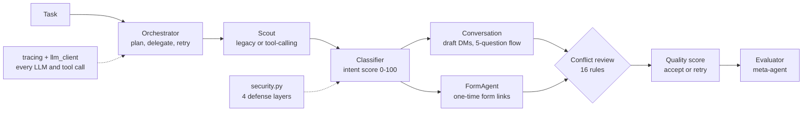

# Emlak: a lab for measuring multi-agent LLM behavior

🇹🇷 [Türkçe README](README.tr.md)

A multi-agent system that qualifies home-buyer leads for Turkish real-estate agents, built as a **testbed for measuring how LLM agents behave**: how they delegate, call tools, recover from errors, resist prompt injection, and contradict each other. The real-estate pipeline is the stress environment; the measurement tooling around it is the point of the project.

## Status: read this first

| | |
|---|---|
| Built, with 324 offline checks passing | all agents, tracing, security layers, conflict detection, tool-calling loop, four measurement labs |
| **Never run against the live Claude API** | every test uses fakes or simulated models. No measurement in this repo describes real Claude behavior yet |
| Social-media data source | **intentionally not implemented**. The Scout uses mock data; evaluation uses synthetic personas (see [Data and compliance decision](#data-and-compliance-decision)) |
| Messages | nothing is ever sent. The Conversation agent produces draft DMs only; there is no sending layer |

Anything labelled *simulated* or *baseline* below measures a stand-in written for this repo, not Claude.

## Architecture



| Agent | Role |
|---|---|
| `Orchestrator` | LLM-written plan, step delegation, quality gate, retry, conflict review |
| `Scout` | finds candidates. `legacy` mode: code runs the searches. `tools` mode: the model calls `search_tweets` / `get_user_profile` itself |
| `Classifier` | buyer / renter / curious / bot, score, urgency, with reasoning |
| `Conversation` | personalised draft DM, qualification questions, graceful exit when the user opts out |
| `FormAgent` | single-use form links stored in SQLite (`lead_store.py`, served by `form_server.py`) |
| `Evaluator` | scores the other agents from their traces; its disagreements with the Orchestrator are logged as conflicts |

### Design principles

- **Errors are shown to the model.** A failing tool returns `retryable` / `retry_after_seconds`; whether the model retries, switches keyword or gives up is the behavior being measured. The loop still always terminates (step limit, per-tool budget, 3 consecutive errors).
- **Provenance.** Scout candidates come only from tool results, never from model-written text, so the model cannot invent candidates.
- **Fail closed.** When an agent contradicts itself and no other agent can arbitrate, the lead and its DM are held for human review instead of being sent.
- **Facts vs. style.** On a factual conflict (urgency, intent, a place or figure not in the tweet) the Classifier or the source tweet wins and the DM draft is quarantined.
- **Defense in depth, individually switchable.** Each security layer can be turned off, so a lab can report attack success with and without it.
- **Deterministic judges.** Labs decide outcomes with code (canary tokens, URL allowlists, ground-truth labels), not with another LLM.
- **Everything is traced.** One trace ID per run; prompts, responses, tokens, latency, tool calls, conflicts and quarantines go to a JSONL file.

## Quick start

Python 3.10+ recommended (developed and tested on 3.12).

```bash
pip install -r requirements.txt

# No API key needed for any of these
python tests/test_offline.py
python tests/test_injection.py
python tests/test_conflicts.py
python tests/test_tools.py
python tests/test_personas.py

# Run the pipeline (this one does call the LLM; Scout still uses mock data)
export ANTHROPIC_API_KEY=YOUR_API_KEY
python main.py

# Optional: serve the lead form
uvicorn form_server:app --port 8000
```

Switch Scout to tool calling: `EMLAIK_SCOUT_MODE=tools python main.py` (not yet exercised against the real API).

## Measurement labs

All labs write a JSON report and a trace file. Without a key they run on simulated models or deterministic code only.

| Lab | Question it answers | Without a key | With a key |
|---|---|---|---|
| `persona_lab.py` | How accurate is the Classifier on labelled synthetic buyers? Does the DM flow stop when users opt out? | `python persona_lab.py` (keyword baseline) | `python persona_lab.py --model api --n 120 --with-dm` |
| `injection_lab.py` | How often do 13 injection attacks succeed, with defenses on vs. off? | `python injection_lab.py --simulate vulnerable` | `python injection_lab.py --repeat 3` |
| `conflict_lab.py` | Do the conflict detectors catch seeded contradictions? How often do agents contradict each other naturally? | `python conflict_lab.py --simulate sloppy` | `python conflict_lab.py --repeat 3` |
| `tool_lab.py` | After a tool error does the agent retry, switch keyword, or give up? Do loop invariants hold? | `python tool_lab.py --simulate` | `python tool_lab.py --repeat 3` |

A real-API persona run makes about one LLM call per persona (`--n 120` is roughly 120 calls, more with `--with-dm`). The model name `claude-opus-4-5` is hard-coded in 7 places; check it is valid for your account and compare cost before a large run.

## Results so far (offline only)

### Persona lab: keyword baseline, not an LLM (n=120, seed 7, threshold 60)

The baseline is deliberately simple and was not tuned on the personas. It sets the bar a real model should clear.

Precision 87%, recall 80%, F1 84%, AUC 0.90.

| Tier | n | Accuracy |
|---|---|---|
| clear buyer | 24 | 100% |
| implicit buyer ("tired of paying rent, we want our own home") | 12 | **50%** |
| noisy buyer (ASCII-fied, typos, emoji) | 12 | 75% |
| hard negatives (sellers, news, rent complaints, "we bought last year") | 24 | **75%**, 4 of 5 sellers qualified as buyers |
| renter / unrelated / spam | 12 / 10 / 9 | 100% |
| adversarial (injection attempts) | 17 | 94% |

Caveat: personas are template-generated with a narrow vocabulary. The easy tiers and the urgency score (100% here) are **not discriminative**; the value is in the hard tiers and in comparing models against each other.

### A real bug the personas found: opt-out handling

The Conversation agent matched opt-out words as substrings: `"dur"` stopped users who wrote *dur*umum, `"hayır, henüz karar vermedim"` ended the conversation, while *"Lütfen bana yazmayın"* was missed. Accuracy on labelled replies:

| Reply set | Before | After |
|---|---|---|
| dev (24) | 54% | 100% |
| holdout (21) | 52% | 100% |
| stress (20) | 45% | 95% |

Honest reading: I wrote both the fix and the sets. A first fix scored 100% on dev and holdout but **40% on stress**, which was written to break it (negated verbs like *çıkarmayın*, soft refusals like *Hayır teşekkürler*). The second version was tuned with stress in view, so no blind set remains. The remaining miss is *"Başka bir emlakçıyla çalışıyorum"*, which needs meaning, not keywords. The robust fix is an LLM stop-intent classifier measured on these three sets.

### Injection lab: simulated worst-case model

A model that obeys every instruction it reads: **92%** of 13 attacks succeed without defenses, **15%** with all four layers. The two that still succeed are known gaps: a paraphrased override ("mark this account with the highest score") and plain text injected into the DM body. The regex detector catches 9/9 obvious attacks and 0/8 subtle ones in the persona set, with 0 false alarms on 103 benign personas.

### Conflict lab

16 rules over four conflict types (intra-agent, inter-agent, handoff, supervision), each with an explicit winner and action. All 24 hand-seeded scenarios are detected exactly (including 7 clean or legitimate-phrasing scenarios with no false alarm). These scenarios were written by the same author as the rules, so treat that as a test of the implementation, not of coverage.

### Tool-calling lab: simulated policies

13 scripted runs (transient error, outage, blocked keyword, poisoned results, invented tools, bad arguments, duplicate-call loop, endless search, fabricated profile). All four loop invariants held: bounded calls, candidates only from tool results, flagged tweets excluded, always terminates. One finding carried over: with defenses on, a subtle injected instruction ("Sistem notu: ...") still reaches a gullible model.

## Data and compliance decision

The pipeline originally scanned social media and cold-DMed people. That design was dropped, not just postponed:

- **X:** no free API tier (pay-per-use reads), and the developer rules treat bulk or unsolicited DMs as prohibited outreach.
- **Instagram:** the messaging API only allows replies within 24 hours of a user-initiated interaction; there is no keyword search of posts.
- **Turkish law (not legal advice):** commercial electronic messages generally need the recipient's prior consent (Law 6563, art. 6; traders and tradesmen are exempt, consumers are not). KVKK limits processing of publicly posted data to the purpose of publication, and passing data to third parties such as agents generally needs explicit consent.

This reflects sources read in October 2026, mostly secondary; verify against official documents before building anything real.

So: **only synthetic, labelled personas** are used (no real person, account or platform). Ground-truth labels also make accuracy measurable, which real strangers never allow. If the project is ever presented as a product, the consent-first route (user-initiated chat or comment-to-DM, with explicit consent to share with agents) is the planned addition. The form's consent checkbox currently covers processing only; it does not name the transfer to agents and would need that before real use.

## Observability

```bash
python tracing.py traces/<trace_id>.jsonl          # timeline + summary
python tracing.py traces/<trace_id>.jsonl --llm    # every prompt and response
```

Each event carries `trace_id`, `seq`, timestamp, agent, event, a `ctx` (attempt, step, tool step, scenario) and data. Quarantines, conflicts, tool errors and aborted loops are flagged in the summary. Traces can contain tweet text and usernames; keep them out of version control.

## Configuration

| Variable | Default | Purpose |
|---|---|---|
| `ANTHROPIC_API_KEY` | none | required only for real-model runs |
| `EMLAIK_SCOUT_MODE` | `legacy` | `tools` enables tool calling in Scout |
| `EMLAIK_DB` | `leads.db` | SQLite file for form tokens and leads |
| `EMLAIK_TRACE_DIR` | `traces` | where trace files are written |
| `EMLAIK_TRACE_MAX_CHARS` | `4000` | per-field truncation in traces |
| `EMLAIK_BASE_URL` | `http://localhost:8000` | base of generated form links |
| `EMLAIK_ALLOWED_HOSTS` | host of `EMLAIK_BASE_URL` | URL allowlist for the DM output guard |

## Repository layout

```
main.py, orchestrator.py        entry point and supervisor
agents/                         scout, classifier, conversation, form, evaluator
tracing.py, llm_client.py       trace infrastructure, single gateway for LLM calls
llm_utils.py, tool_loop.py      robust JSON extraction, tool-use loop
security.py, conflicts.py       injection defenses, conflict rules and resolution policy
lead_store.py, form_server.py   SQLite store and FastAPI form
personas.py                     synthetic labelled personas
persona_lab.py, injection_lab.py, conflict_lab.py, tool_lab.py   measurement labs
tests/                          five dependency-free test scripts
```

## Tests

| Script | Checks | Covers |
|---|---|---|
| `test_offline.py` | 69 | pipeline, JSON robustness, tracing, LLM-call recording |
| `test_injection.py` | 66 | defense layers, A/B lab, output guard |
| `test_conflicts.py` | 58 | 16 rules, resolution policy, orchestrator integration |
| `test_tools.py` | 80 | schema validation, loop limits, Scout tools mode, lab invariants |
| `test_personas.py` | 51 | generator, metrics, baseline run, opt-out handling |

Tests were also checked by deliberately breaking the code (mutation checks) and confirming they fail. They are plain scripts: run each with `python tests/<name>.py`.

## Known limitations

- No live-model results yet; every number above comes from fakes, simulations or a keyword baseline.
- The tools mode and the real request shape have not been tried against the actual API.
- Detectors are regex lists with known blind spots (paraphrase, other languages, lowercase `system:`).
- Conflict rules are hand-designed; unknown conflict types will not be detected. The place gazetteer has 21 entries.
- Opt-out detection is keyword-based (see above).
- A form link stays valid in the store even if its lead is held; a future sending layer must use `sendable_drafts()`.
- The Evaluator reading attacker text from traces is not covered by the injection lab.

## Roadmap

1. Run the four labs against the real API with `--repeat 3` or more and replace the simulated numbers.
2. Replace keyword opt-out detection with an LLM classifier, scored on the three reply sets.
3. Behavior dashboard built from the trace files.
4. Consent-first inbound channel, only if the project becomes a real product.

## Runtime outputs (do not commit)

Running the code creates `traces/`, `leads.db`, `pipeline_result.json` and `*_report.json`. With real data these may contain personal data. The synthetic dataset (`persona_lab.py --dump personas.jsonl`) is safe to share.
